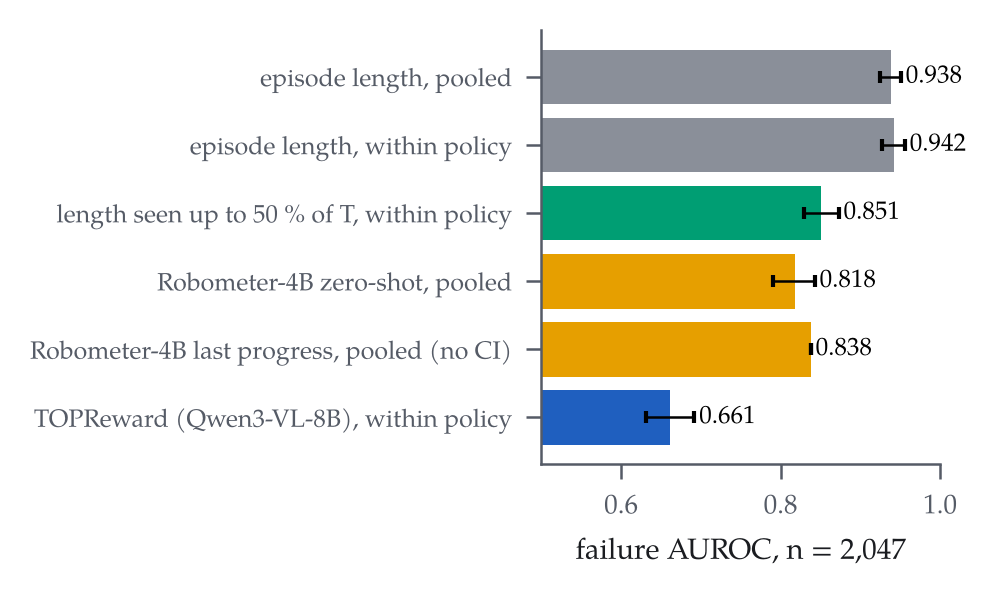
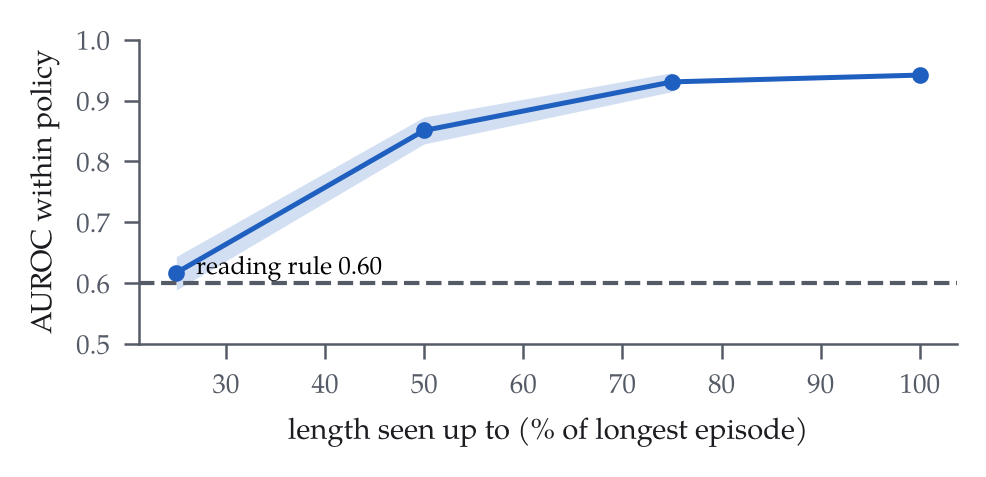
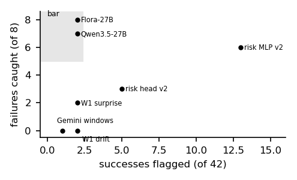

# What a reward model can show depends on who stopped the episode: failure judges and monitors on a low-cost arm

*Ravindu Somawansa, Shisso Robotics, Paris — draft, 4-page workshop version. Rendered by `make_paper.py` from the
result files; every number is a placeholder filled from `numbers.json`, which records each value's anchor. The
appendix maps every analysis to its result file and protocol.*

## Abstract

Reward models that score robot rollouts are increasingly used as failure detectors, and papers that evaluate them in
this role normally compare them against other learned detectors. We argue that the baseline to beat depends on a
property of the dataset that such papers do not report: how its episodes end. We compared two zero-shot reward models
with plain episode length. On ArmnetBench, a public SO-101 benchmark whose operators stopped each rollout without a
time limit, length separates failure from success at AUROC 0.942 within policy; failed runs are slow rather
than cut off, and length observed only up to half of the longest episode still gives 0.851. Both zero-shot
reward models score below length, the better one at 0.821, and the released fine-tune reaches 0.994
only when scored on its own training episodes. On our own rollouts, where an operator stopped each run by judgment,
the picture reverses: length falls to 0.56 and neither reward model beats the identity of the policy. A
judge that sees the finished episode passes its threshold, at an operating point chosen in-sample, whereas no
mid-episode monitor reaches its bar. Our findings suggest that a reward model evaluated as a failure detector should
be reported alongside episode length within policy on the same rows, together with the dataset's stopping rule.

## 1 Introduction

Papers that evaluate a reward model as a failure detector normally compare it with other learned detectors, and
seldom with the simplest signals available. On ArmnetBench, however, the operator stopped each rollout and there was
no set time limit, so successes are cut at completion while failures run on, and the length of an episode therefore
encodes its outcome. The identity of the policy that ran can carry the outcome as well (mainly where some models give
out-of-distribution results), and we call this second signal the policy-identity null. On our own rollouts the operator
stopped each run by his judgment, and both signals are weaker. We refer to the way a dataset ends its episodes as its
stopping rule. To the best of our knowledge, none of the reward-model papers in our library reports the stopping rule
or a length baseline.

We began with a narrower claim, namely that elapsed time is the reward model to beat. Our own rollouts did not support
it: length is near chance on them, and a robot-trained judge passed its pre-registered threshold. Since what differs
between the two datasets is how their episodes ended, the stopping rule became the subject of this paper.

We measured length on ArmnetBench and on our own rollouts. The length analyses were frozen before any
number existed. We compared length with two zero-shot reward models, Robometer and TOPReward
, and on our 88 operator-stopped rollouts we also compared it with every judge and monitor we had run.


## 2 Data and labels

ArmnetBench v0.1 has 8 tasks and 7 policies on the SO-101. We use its 2,047 policy rollouts
that carry a success or failure class (515 successes, 1,532 failures) and leave out the teleoperated
episodes. One task, pushing a Displayport cable (270 rollouts), has rollouts of a single class and therefore has
no per-task AUROC. Our own data consist of 88 labelled bowls-task episodes on one SO-101 arm with a Jetson Orin NX, of
which every monitor gate used the same 50-episode subset (42 successes, 8 failures). A single operator, the author,
stopped each run, labelled it at rest, and was not blind to the policy.

## 3 The length baseline

On ArmnetBench, episode length is a strong failure detector within each policy (Table 1, Fig. 2). Pooled over policies
it reaches 0.938, and within each policy it ranges from 0.91 to 0.96. Pair-weighted,
the within-policy value is 0.942, with a CI of 0.927–0.956.

The within-policy value pair-weights the per-policy AUROCs (`repro/length-null/scripts/length_analysis.py`):

```python
def stratified(df, score, by="policy_type"):
    """Pair-weighted mean of per-stratum AUROCs (weights successes x failures)."""
    num = den = 0.0
    for _, g in df.groupby(by):
        a = auroc(g.y, g[score]); w = g.y.sum() * (~g.y).sum()
        if a is not None:
            num += a * w; den += w
    return num / den if den else None
```

We ran Robometer-4B zero-shot, as its authors ship it. It scores 0.818 pooled and 0.821
within policy (CI 0.794–0.847), and its paired difference to length has a 95 % CI of -0.150 to
-0.094. We ran TOPReward with Qwen3-VL-8B and no training; it scores 0.661
within policy, with a paired difference to length whose 95 % CI is -0.31 to -0.25. In both cases the
protocol fixed the model's primary score before any score existed: for Robometer the success probability, for
TOPReward the success score of its paper. Two further scores from the same runs appear in Table 1 as descriptive rows;
they are higher, and still below length.

Table 1: ArmnetBench, failure AUROC with 95 % episode-bootstrap CIs. Read down the within-policy column: no zero-shot reward-model score reaches length, and the fine-tune row is in-sample.

| signal | pooled | within policy |
|---|---|---|
| episode length | 0.938 (0.925–0.951) | 0.942 (0.927–0.956) |
| length seen up to 50 % of the longest run | — | 0.851 (0.829–0.873) |
| Robometer-4B, success probability | 0.818 (0.790–0.843) | 0.821 (0.794–0.847) |
| Robometer-4B, last progress (descriptive) | 0.838 (no CI) | — |
| Robometer-4B fine-tuned on ArmnetBench, success probability (in-sample) | 0.994 (0.991–0.996) | 0.994 (0.992–0.997) |
| TOPReward, success score | 0.653 (0.623–0.684) | 0.661 (0.631–0.692) |
| TOPReward, Yes/No component (descriptive) | — | 0.678 |



The obvious reply to a zero-shot result is to fine-tune, so we also scored the released ArmnetBench fine-tune of
Robometer, `jesbu1/robometer-4b-fft-armnet-tiled`. Its model card lists a dataset of all 2,499 ArmnetBench
episodes, with no held-out split, as its training data; every episode we score was therefore a training episode with
its label, and the result is in-sample. On the 2,047 rollouts it scores 0.994 pooled and 0.994
within policy, 0.052 above length (paired CI 0.039 to 0.067). This shows that the labels can be fit;
it does not show that a reward model beats length on rollouts it has not seen. We gave it 8 frames spread over the 64
of each tiled video, the length it was trained on. Scoring all 64 frames on 160 episodes gives 0.995
pooled against 0.989 for 8 frames.

## 4 Length is more than the longest episode

One might suspect that length detects failures only because failed episodes run to a timeout. This is not what we
observe. Only 8.7 % of failures run as long as the task's longest episode, which we use as a reference length
(the benchmark sets no time limit). At half that length, 88 % of failures are still running and only
19 % of successes are, and length observed up to that cut gives 0.851 within policy (Fig. 3),
with a CI of 0.829–0.873. TOPReward on frames up to the same cut reaches 0.667, and Robometer's
success probability at the last frame before the cut gives 0.814 within policy (CI 0.787–0.839),
below length at that cut. The ordering is not uniform over the episode: at a quarter of the longest episode it is
reversed, 0.706 for Robometer against 0.617 for length, and by three quarters length is ahead again,
0.931 against 0.821. These are prefixes of one pass over the whole episode (§7). In other words, failed
rollouts are slow, and most of them do not reach the task's longest episode; both readings fixed in the protocol hold.



> **Own rollouts.** On our own operator-stopped rollouts, length is at chance: it gives 0.56 on the 69 rollouts
> TOPReward scored and 0.52 on all 88. Here the policy-identity null is the baseline to beat, since
> 17 of the 25 failures in the 69 come from one policy, TurboVLA.
> Neither reward model beats policy identity. TOPReward scores 0.82 (CI 0.70–0.93), against
> 0.87 for policy identity alone, and 0.78 on the 50 episodes without TurboVLA.
> Robometer scores 0.577 on all 88, and policy identity 0.878.


## 5 Judges and monitors on our rollouts

Table 2 gives each judge and monitor a threshold-free AUROC where one is defined, together with the failures caught
and the successes flagged at the operating point. For the judges at rest, that point is chosen in-sample.

We first ran a deterministic top-camera check, built from colour masks and geometry with no learning. It is right on
94.3 % of judged episodes, with 0 false positives and 5 false negatives (Wilson interval on
the false positives 0–13 %). We then gave Flora-Rewarder-27B a 64-frame two-view clip and NVIDIA's
prompt. Its threshold-free AUROC is 1.00 (bootstrap CI 1.00–1.00), and at its in-sample
operating point it flags 8 of 8 failures at 2 of 42 successes, with a Wilson interval on those false
alarms of 1–16 %. Since the pre-registered bar was at least 6 of 8 failures at no more than 2 of 42 successes,
it passes. Surprisingly, its base model, Qwen3.5-27B, which has no robot fine-tune, also passes on the same
input, with AUROC 0.91 (CI 0.78–1.00) and 7 of 8 at 2 of 42. The input format
mattered more than the fine-tune. Qwen3.5-9B flags 16 successes and fails, and Gemini 3.8 Flash
 fails by one false alarm.

The bar for mid-episode monitors is at least 5 of 8 failures at no more than 1 of 20 false interventions, and no
monitor reaches it on these 50 rollouts (Fig. 4). The surprise of a separate world model, trained in the LeWorldModel
recipe, catches 2 of 8 at 2 of 42, with an AUROC of 0.86. A Gemini sliding-window
judge catches 0. The first action-conditioned risk head on the world model's latent reached an AUROC of
0.93, but on inspection it had read elapsed time, so we withdrew that result and pre-registered a second
version without time or length. That version catches 3 of 8 at 5 of 42, with an AUROC of
0.79 that falls to 0.71 when the actions are shuffled. The MLP variant catches 6 of 8 and
flags 13 of 42.

Table 2: Judges and monitors on the 50 operator-stopped rollouts (42 successes, 8 failures). Judges see the finished episode; monitors are held to ≥ 5/8 caught at ≤ 1/20 false interventions.

| method | kind | AUROC | caught / 8 | flagged / 42 | threshold |
|---|---|---|---|---|---|
| colour judge (no learning) | at rest | — (94.3 % right, 0 FP, 5 FN) | — | — | fixed rule |
| Flora-Rewarder-27B | at rest | 1.00 (1.00–1.00) | 8 | 2 | in-sample |
| Qwen3.5-27B, same input | at rest | 0.91 (0.78–1.00) | 7 | 2 | in-sample |
| Qwen3.5-9B, same input | at rest | 0.75 | 7 | 16 | in-sample |
| Gemini 3.8 Flash, same input | at rest | 0.96 | 8 | 3 | in-sample |
| Gemini sliding windows | monitor | — | 0 | 1 | fixed before scoring |
| world-model surprise | monitor | 0.86 | 2 | 2 | fixed before scoring |
| world-model latent drift | monitor | 0.30 | 0 | 2 | fixed before scoring |
| risk head, logistic (v2) | monitor | 0.79 | 3 | 5 | 5-fold by episode |
| risk head, MLP (v2) | monitor | — | 6 | 13 | 5-fold by episode |



## 6 Related work

Robometer scales a general-purpose reward model through trajectory comparisons, and TOPReward
 reads the token probabilities of a video-language model as hidden rewards; a survey of verifiers for
robot policies covers the wider family. FAIL-Detect and SAFE learn uncertainty-
and feature-based failure scores for imitation and VLA policies, and FARM reads failure signals from the
internal states of a frozen world model, as our world-model monitors do. Our risk head follows ReAP, which
predicts action-conditioned risk. VLA-Corrector verifies stages, Spotter adds a reflecting
VLM, and REMORA tracks progress through errors and recovery. ArmnetBench and a standardized
SO-101 VLA benchmark evaluate policies on the same arm. In none of these did we find a report of the
elapsed-length baseline under the dataset's stopping rule, which is the comparison this paper adds.

## 7 Limitations

The judge pass on our own rollouts rests on 8 failures, and its operating thresholds were chosen on the same 50
episodes; a single operator, the author, labelled them and was not blind to the policy. The threshold-free AUROCs do
not depend on the threshold, and fresh rollouts scored at the frozen thresholds would confirm the operating points.
Because 17 of the 25 failures in our 69 rollouts are TurboVLA's, any score that reads the
policy obtains the policy-identity null for free. The risk head is trained and tested on the same 50 episodes; five
folds by episode keep episodes from leaking, but tasks and policies leak. The fine-tune comparison is in-sample, since
the release has no held-out episodes, and its config needed three training-only keys removed to load in the pinned
code. Robometer's truncated scores are prefixes of one pass over the whole episode, and because a frame's value may
depend on later frames, a pass over a clip that ends at the cut could give a different number. The 462
episodes that ran out of memory in the first pass were scored in a second pass on a larger GPU, with every frame kept.
TOPReward's paper does not give its prefix count, frames per query or Yes/No wording, so those are our choices.
Finally, the ArmnetBench result covers eight tasks, and the reference length is each task's longest episode, since the
benchmark sets no time limit.

## 8 Conclusion

> **Conclusion.** On ArmnetBench, where the operator stopped each rollout and there was no set time limit, episode length beat both zero-shot reward models, and a fine-tune beat it only on the episodes it was trained on. On our own operator-stopped
> rollouts length was at chance, and a judge that saw the whole finished episode caught the failures. We conclude that a reward model evaluated as a failure detector should be reported together with episode length within policy on the same rows and with a statement of how the episodes ended; without both, a comparison against other learned detectors does not show what the reward model adds.


## Appendix: from plain name to analysis

Every number is recomputable from the repository; this table maps each analysis to its files. The frozen commits named in the last column are in ravediamond/road-to-robotics, not in this repository's history; the protocols are copied here verbatim.

| analysis | repro folder | expected files | protocol |
|---|---|---|---|
| length baseline, truncation | repro/length-null | length_armnetbench.json, counts_ci.json | LENGTH_PROTOCOL.md, frozen `1a69f30` |
| Robometer on ArmnetBench | repro/robometer-judge, repro/length-null | g9a_ab_complete.json, robometer_length.json | PROTOCOL.md (primary score fixed there); length-null amendment 2026-11-05 |
| Robometer fine-tune on ArmnetBench (in-sample) | repro/robometer-judge | ft_rows.jsonl, ft_results.json | PROTOCOL_FT.md (frozen before any score; deviations numbered) |
| Robometer and length on own rollouts | repro/robometer-judge | g9a_own.json | PROTOCOL.md |
| colour judge | repro/robometer-judge | g9c3_test_results.json | PROTOCOL.md |
| TOPReward, both datasets | repro/topreward | topreward.json, own_rollout_labels.csv | TOPREWARD_PROTOCOL.md, `6241570` |
| judges at rest, input-format gate | repro/flora-input-format | g_flora_summary.json, g_flora_abl_summary.json | PROTOCOL.md |
| window judge, world-model monitors | repro/six-monitors | judge_tau.json, w1a_summary.json | PROTOCOL.md |
| action-conditioned risk head | repro/reap | monitors.json, monitors_v2.json | PROTOCOL.md |

## References (ids from the papers mirror)

Robometer — arXiv:2603.02115 · TOPReward — arXiv:2602.19313 · No Free Checker — arXiv:2609.09250 ·
FAIL-Detect — arXiv:2503.08558 · SAFE — arXiv:2506.09937 · FARM — arXiv:2609.11445 · ReAP — arXiv:2610.16309 ·
VLA-Corrector — arXiv:2609.06508 · Spotter — arXiv:2609.36808 · REMORA — arXiv:2610.39125 ·
ArmnetBench — arXiv:2607.24481 · SO-101 benchmark — arXiv:2606.08881 · LeWorldModel — arXiv:2603.19312 ·
TurboVLA — arXiv:2607.27205 · Flora-Rewarder-27B — NVIDIA model card · Qwen3-VL-8B, Qwen3.5 — model cards ·
Gemini 3.8 Flash — Google model page.
