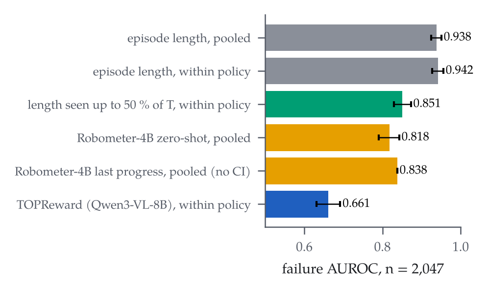
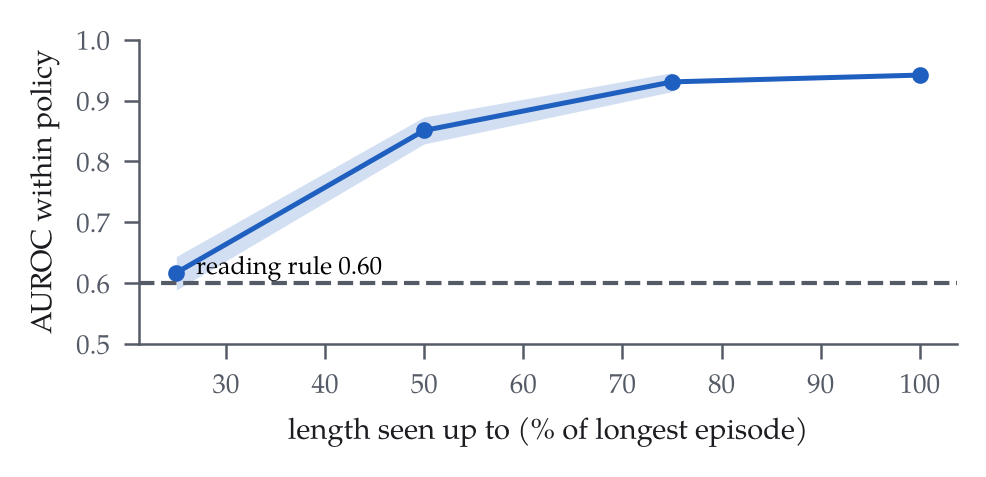
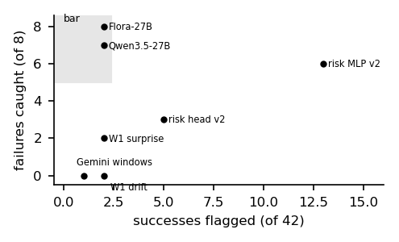

# What a reward model can show depends on who stopped the episode: failure judges and monitors on a low-cost arm

*Ravindu Somawansa, Shisso Robotics, Paris — draft, 4-page workshop version. Rendered by `make_paper.py` from the
result files; every number is a placeholder filled from `numbers.json`, which records each value's anchor. The
appendix maps every analysis to its result file and protocol.*

## Abstract

Episode length is a failure detector that zero-shot reward models must beat, and how hard it is to beat depends on
who stopped the episode. On public SO-101 rollouts that end at a time limit, length alone separates failure from
success at AUROC {{len_within}} within policy. It does not need the timeout: watched only up to half of the longest
episode, it still gives {{t50_within}}, because failed runs are slow rather than cut off. Both reward models we test
score below it, the better one at {{rbm_within}}. On our own rollouts, which an operator stopped by judgment, length
falls to {{topr_own_len}} and the picture reverses. Neither reward model beats the identity of the policy, a judge
that sees the finished episode passes its bar (at a threshold chosen in-sample), and every mid-episode monitor misses.
So report a within-policy length baseline, and name the dataset's stopping rule.

## 1 Introduction

A reward model that scores robot rollouts is also a failure detector, and papers evaluate it as one, mostly against
other learned detectors. The baseline that matters is often simpler. When a benchmark stops failed runs at a time
limit, the length of an episode encodes its outcome, and so does the identity of the policy that ran (we call the
second one the policy-identity null). When an operator stops each run by judgment, both signals collapse and the
detection task changes with them. Which of the two a dataset uses is its *stopping rule*, and none of the
reward-model papers in our library reports it or the length baseline it implies.

We started with a narrower claim, that elapsed time is the reward model to beat. Our own rollouts broke it: there,
length is near chance and a robot-trained judge passed its bar. The stopping rule is what separates the two results,
so it became the subject of the paper.

We measured length on a public SO-101 benchmark [@armnetbench] and on our own rollouts, with the length analyses
frozen before any number existed, and set against it two zero-shot reward models [@robometer; @topreward] and every
judge and monitor we had run on our {{own_n}} operator-stopped rollouts.

## 2 Data and labels

ArmnetBench v0.1 [@armnetbench] covers the SO-101 with 8 tasks and {{n_pol}} policies. We use its {{ab_n}} policy
rollouts with a success or failure class ({{ab_ok}} successes, {{ab_fail}} failures) and leave out the teleoperated
episodes. One task, pushing a Displayport cable ({{dp_n}} rollouts), has rollouts of a single class and so no per-task
AUROC. Our own data are 88 labelled bowls-task episodes on one SO-101 arm with a Jetson Orin NX, and the 50-episode
subset (42 successes, 8 failures) that every monitor gate used. The author was the operator: he stopped each run and
labelled it at rest, not blind to the policy.

## 3 The length baseline

On ArmnetBench, episode length is a strong failure detector, and not only because it tells the policies apart
(Table 1, Fig. 1). Pooled over policies it reaches {{len_pooled}}. Within each policy it ranges from {{len_pol_min}}
to {{len_pol_max}}, or {{len_within}} pair-weighted, with a CI of {{len_within_lo}}–{{len_within_hi}}.

Both reward models fall below it. Robometer-4B [@robometer], run zero-shot as its authors ship it, scores
{{rbm_pooled}} pooled and {{rbm_within}} within policy (pair-weighted over its per-policy scores, whose range stands in
for a CI; §7 says why). TOPReward [@topreward], with Qwen3-VL-8B [@qwen3vl] and no training, scores {{topr_within}}
within policy, and its paired difference to length has a 95 % CI of {{topr_d_lo}} to {{topr_d_hi}}. The protocols
fixed each model's primary score before any score existed (Robometer's success probability, and the success score of
TOPReward's paper). The two descriptive rows of Table 1, read from the same runs, score higher but still below
length.

Table 1: ArmnetBench, failure AUROC with 95 % episode-bootstrap CIs. Read down the within-policy column: no reward-model score reaches length.

| signal | pooled | within policy |
|---|---|---|
| episode length | {{len_pooled}} ({{len_pooled_lo}}–{{len_pooled_hi}}) | {{len_within}} ({{len_within_lo}}–{{len_within_hi}}) |
| length seen up to 50 % of the longest run | — | {{t50_within}} ({{t50_lo}}–{{t50_hi}}) |
| Robometer-4B, success probability | {{rbm_pooled}} ({{rbm_lo}}–{{rbm_hi}}) | {{rbm_within}} (per-policy {{rbm_within_min}}–{{rbm_within_max}}) |
| Robometer-4B, last progress (descriptive) | {{rbm_prog}} (no CI) | — |
| TOPReward, success score | {{topr_pooled}} ({{topr_pooled_lo}}–{{topr_pooled_hi}}) | {{topr_within}} ({{topr_lo}}–{{topr_hi}}) |
| TOPReward, Yes/No component (descriptive) | — | {{topr_yn_within}} |

## 4 Is it the timeout?

If length only reflected the timeout, its signal would sit in the few runs that hit it. We take each task's longest
episode as its timeout, and only {{hit_fail}} % of failures run that long. At half that length, {{t50_run_fail}} % of
failures are still running but only {{t50_run_ok}} % of successes. Length observed up to that cut gives
{{t50_within}} within policy (CI {{t50_lo}}–{{t50_hi}}; Fig. 2), and TOPReward on frames up to the same cut reaches
{{topr_cap}}. Failed rollouts are slow, not timed out. Both readings the protocol fixed in advance hold: length is a
real within-policy null, and it is more than the timeout.

On our own operator-stopped rollouts the same baseline is at chance: {{topr_own_len}} on the {{topr_own_n}} rollouts
TOPReward scored and {{own_len}} on all {{own_n}}. The baseline that matters here is the policy-identity null, because
{{own_turbo_fail}} of the {{own_fail}} failures in the {{topr_own_n}} come from one policy, TurboVLA [@turbovla].
Neither reward model beats it. TOPReward scores {{topr_own}} (CI {{topr_own_lo}}–{{topr_own_hi}}) against
{{topr_own_pol}} for policy identity alone, and {{topr_own_nt}} on the {{topr_own_nt_n}} episodes without TurboVLA.
Robometer scores {{own_rbm}} against {{own_rbm_pol}} on all {{own_n}}.

## 5 Judges and monitors on our rollouts

Table 2 reports every judge and monitor the same way: a threshold-free AUROC where one is defined, then failures caught
and successes flagged at the operating point. The judges at rest have their operating thresholds chosen in-sample on
the same 50 episodes (their AUROCs are not).

A judge that sees the finished episode works on these rollouts, and the input format matters more than the robot
fine-tune. A deterministic top-camera check (colour masks and geometry, no learning) is right on {{g9c3_acc}} % of
judged episodes, with {{g9c3_fp}} false positives (Wilson {{g9c3_fp_ci}}) and {{g9c3_fn}} false negatives. Given a
64-frame two-view clip and NVIDIA's prompt, Flora-Rewarder-27B [@flora27b] reaches a threshold-free AUROC of
{{flora_auc}} (bootstrap CI {{flora_lo}}–{{flora_hi}}). At its in-sample operating point it flags {{flora_f}} of 8
failures at {{flora_s}} of 42 successes (Wilson on the false alarms {{flora_s_ci}}), which passes the pre-registered
bar of at least 6 of 8 failures at no more than 2 of 42 successes. Its base model Qwen3.5-27B [@qwen35], without the
robot fine-tune, passes the same bar on the same input: AUROC {{q27_auc}} ({{q27_lo}}–{{q27_hi}}), {{q27_f}} of 8 at
{{q27_s}} of 42. The smaller Qwen3.5-9B [@qwen35] and Gemini 3.8 Flash [@gemini38] fail it, the 9B by flagging
{{q9_s}} successes and Gemini by one false alarm too many.

No mid-episode monitor meets its bar of at least 5 of 8 failures at no more than 1 of 20 false interventions (Fig.
3). The surprise of a separate world model, trained in the LeWorldModel recipe [@lewm], comes closest with {{w1_l2}}
of 8 at {{w1_l2_fi}} of 42 (AUROC {{w1_l2_auc}}). A Gemini sliding-window judge catches {{tau_caught}}. The
action-conditioned risk head on the world model's latent has a history. Its first version reached AUROC
{{r1_log_auc}}, but it read elapsed time, so we withdrew that result and pre-registered a second version without time
or length. The second version catches {{r2_log_c}} of 8 at {{r2_log_fi}} of 42, with AUROC {{r2_log_auc}} against
{{r2_sh_auc}} when its actions are shuffled, and its MLP variant catches {{r2_mlp_c}} of 8 but flags {{r2_mlp_fi}} of 42.

Table 2: Judges and monitors on the 50 operator-stopped rollouts (42 successes, 8 failures). Judges see the finished episode; monitors are held to ≥ 5/8 caught at ≤ 1/20 false interventions.

| method | kind | AUROC | caught / 8 | flagged / 42 | threshold |
|---|---|---|---|---|---|
| colour judge (no learning) | at rest | — ({{g9c3_acc}} % right, {{g9c3_fp}} FP, {{g9c3_fn}} FN) | — | — | fixed rule |
| Flora-Rewarder-27B | at rest | {{flora_auc}} ({{flora_lo}}–{{flora_hi}}) | {{flora_f}} | {{flora_s}} | in-sample |
| Qwen3.5-27B, same input | at rest | {{q27_auc}} ({{q27_lo}}–{{q27_hi}}) | {{q27_f}} | {{q27_s}} | in-sample |
| Qwen3.5-9B, same input | at rest | {{q9_auc}} | {{q9_f}} | {{q9_s}} | in-sample |
| Gemini 3.8 Flash, same input | at rest | {{gem_auc}} | {{gem_f}} | {{gem_s}} | in-sample |
| Gemini sliding windows | monitor | — | {{tau_caught}} | {{tau_fi}} | fixed before scoring |
| world-model surprise | monitor | {{w1_l2_auc}} | {{w1_l2}} | {{w1_l2_fi}} | fixed before scoring |
| world-model latent drift | monitor | {{w1_cos_auc}} | {{w1_cos}} | {{w1_cos_fi}} | fixed before scoring |
| risk head, logistic (v2) | monitor | {{r2_log_auc}} | {{r2_log_c}} | {{r2_log_fi}} | 5-fold by episode |
| risk head, MLP (v2) | monitor | — | {{r2_mlp_c}} | {{r2_mlp_fi}} | 5-fold by episode |

## 6 Related work

Robometer [@robometer] and TOPReward [@topreward] are the two reward models we test. Robometer scales a
general-purpose reward model through trajectory comparisons, and TOPReward reads the token probabilities of a
video-language model as hidden rewards. A survey of verifiers for robot policies [@nofreechecker] maps the wider
family. Mid-episode failure detection is its own line of work, and our monitors borrow from it. FAIL-Detect
[@faildetect] and SAFE [@safe] learn uncertainty- and feature-based failure scores for imitation and VLA policies.
FARM [@farm] reads failure signals from the internal states of a frozen world model, close to our world-model
monitors, and ReAP [@reap] predicts action-conditioned risk, the idea behind our risk head. VLA-Corrector
[@vlacorrector], Spotter [@spotter] and REMORA [@remora] add stage verification, a reflecting VLM and recurrent
progress tracking.
ArmnetBench [@armnetbench] and a standardized SO-101 VLA benchmark [@so101bench] evaluate policies on the same
low-cost arm. None of these works reports the elapsed-length baseline under the dataset's stopping rule, and that
comparison is what this paper adds.

## 7 Limitations

The result most likely to move is the judge pass on our own rollouts. It rests on 8 failures, labels the author gave
without being blind to the policy, and operating thresholds chosen on the same 50 episodes; fresh rollouts scored at
those frozen thresholds would test it. Policy identity is the next concern: {{own_turbo_fail}} of the {{own_fail}}
failures in our 69 rollouts are TurboVLA's, so any score that reads the policy gets the policy-identity null for free.
The risk head is trained and tested on the same 50 episodes (five folds by episode keep episodes from leaking, but
tasks and policies do leak). Robometer's within-policy number has no episode-bootstrap CI and Robometer is missing
from the truncation analysis, because its per-episode scores stayed on an older machine; a copy from that machine or a
re-score of about ${{rbm_rescore}} would restore both. TOPReward's paper does not give its prefix count, frames per
query or Yes/No wording, so those are our choices. The ArmnetBench result covers eight tasks, and the timeout is
approximated by each task's longest episode.

## 8 Conclusion

Before evaluating a reward model as a failure detector, run episode length within policy on the same rows, and say how
the episodes ended. On a benchmark that stops at a time limit, length was the detector to beat, and neither reward
model beat it. On rollouts an operator stopped, length was useless, and what caught failures was a judge that saw the
whole finished episode in the right input format.

## Appendix: from plain name to analysis

Every number is recomputable from the repository; this table maps each analysis to its files.

| analysis | repro folder | expected files | protocol |
|---|---|---|---|
| length baseline, truncation | repro/length-null | length_armnetbench.json, counts_ci.json | LENGTH_PROTOCOL.md, frozen `1a69f30` |
| Robometer on ArmnetBench | repro/robometer-judge | g9a_ab_complete.json | PROTOCOL.md (primary score fixed there) |
| Robometer and length on own rollouts | repro/robometer-judge | g9a_own.json | PROTOCOL.md |
| colour judge | repro/robometer-judge | g9c3_test_results.json | PROTOCOL.md |
| TOPReward, both datasets | repro/topreward | topreward.json, own_rollout_labels.csv | TOPREWARD_PROTOCOL.md, `6241570` |
| judges at rest, input-format gate | repro/flora-input-format | g_flora_summary.json, g_flora_abl_summary.json | PROTOCOL.md |
| window judge, world-model monitors | repro/six-monitors | judge_tau.json, w1a_summary.json | PROTOCOL.md |
| action-conditioned risk head | repro/reap | monitors.json, monitors_v2.json | PROTOCOL.md |

## References (ids from the papers mirror)

Robometer — arXiv:2603.02115 · TOPReward — arXiv:2602.19313 · No Free Checker — arXiv:2609.09250 ·
FAIL-Detect — arXiv:2503.08558 · SAFE — arXiv:2506.09937 · FARM — arXiv:2609.11445 · ReAP — arXiv:2610.16309 ·
VLA-Corrector — arXiv:2609.06508 · Spotter — arXiv:2609.36808 · REMORA — arXiv:2610.39125 ·
ArmnetBench — arXiv:2607.24481 · SO-101 benchmark — arXiv:2606.08881 · LeWorldModel — arXiv:2603.19312 ·
TurboVLA — arXiv:2607.27205 · Flora-Rewarder-27B — NVIDIA model card · Qwen3-VL-8B, Qwen3.5 — model cards ·
Gemini 3.8 Flash — Google model page.
